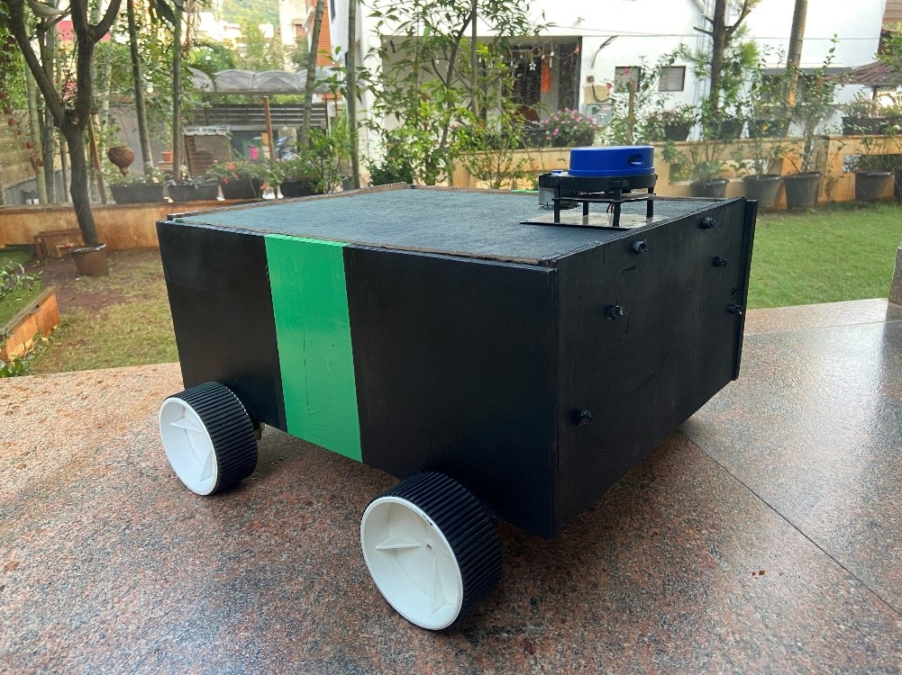
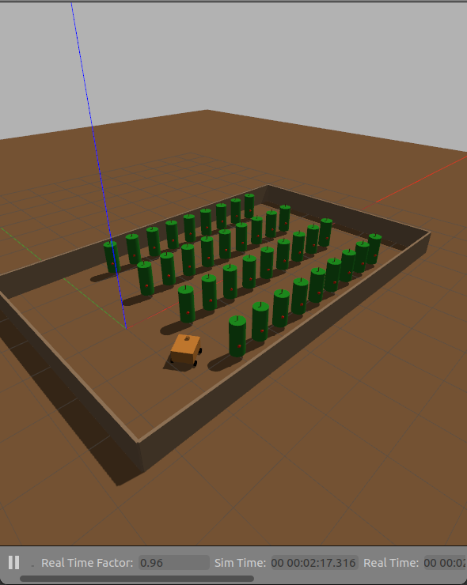
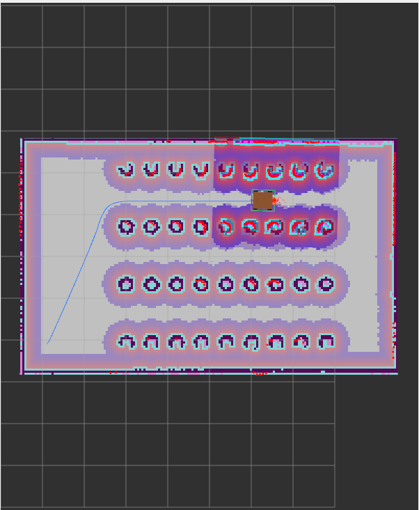
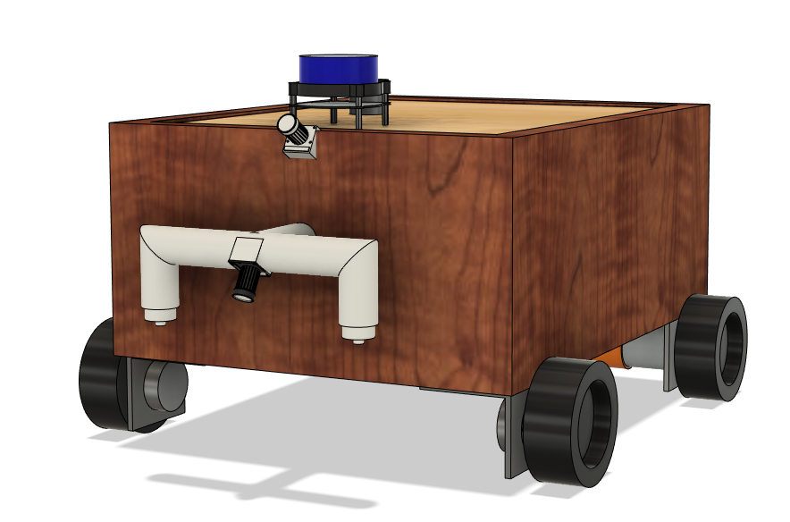
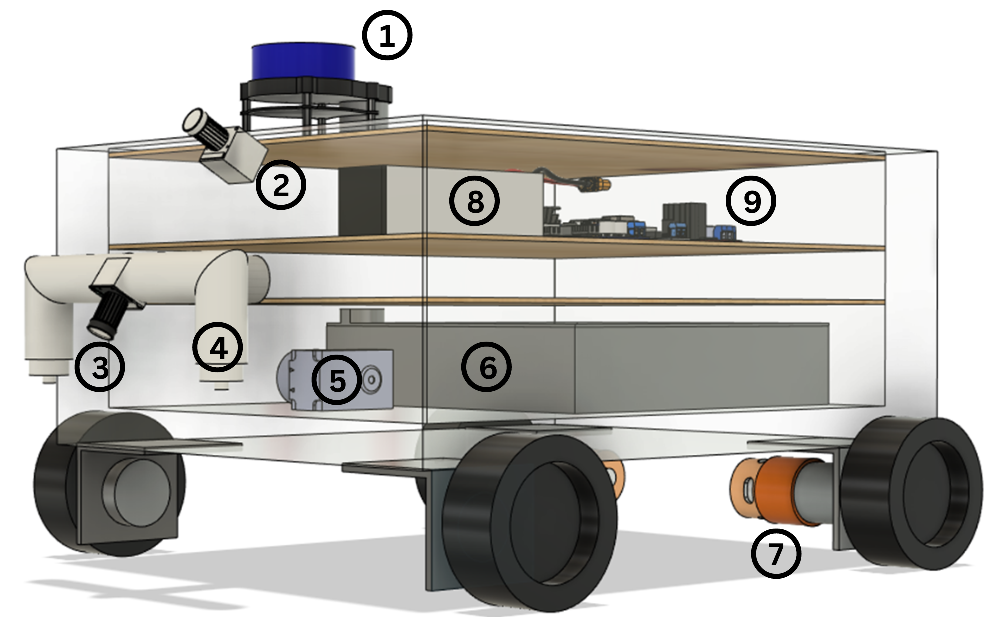
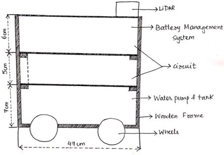
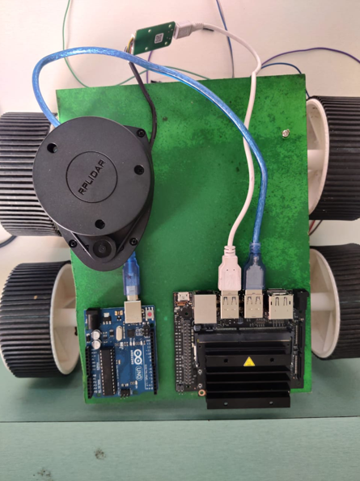
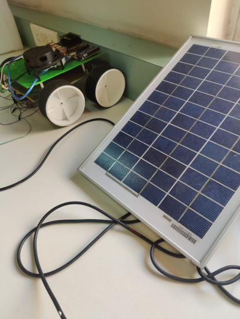

# AgriDoc Farm Robot

AgriDoc is a small farm robot for tomato fields. It drives up and down the plant rows on its own, finding its way with GPS and using its lidar to keep clear of the plants and anything else in the way. While it drives, a camera pointed at the ground looks for weeds and sprays them. A second camera looks at the plants and logs every leaf disease it finds with the robot's position on the map.

The project has two parts:

- **Part 1, autonomous navigation:** a Gazebo simulation of a tomato field, GPS localization with robot_localization, Nav2 for path following, a serpentine patrol through the rows and the bringup for the real robot (Jetson Nano and Arduino Mega). Lidar mapping with slam_toolbox is there for the simulation as well.
- **Part 2, detection:** a CNN that classifies tomato leaf diseases (TensorFlow) and a YOLOv5 model that finds weeds. Both run on the robot as ROS 2 nodes.

## Simulation

 

Videos of the GPS patrol: [Gazebo and RViz side by side](docs/videos/gps_patrol_gazebo_rviz.mp4), [Gazebo](docs/videos/gps_gazebo_patrol.mp4), [RViz](docs/videos/gps_rviz_patrol.mp4).

Videos of the lidar patrol on the saved map: [Gazebo and RViz side by side](docs/videos/patrol_gazebo_rviz.mp4), [Gazebo](docs/videos/gazebo_patrol.mp4), [RViz](docs/videos/rviz_patrol.mp4).

## Hardware

| Part | Used for |
|---|---|
| Jetson Nano (JetPack 4.6.1) | ROS 2, navigation and both detection models |
| Arduino Mega | motors, encoders, IMU, GPS and pump, talks to the Jetson over USB |
| L298N motor driver | the two drive motors |
| 2 x PG36M555 12 V 99.5:1 motors with hall encoders | rear wheels (radius 0.05 m, 0.42 m apart), the front wheels roll freely |
| BNO055 (Adafruit board) | gyro for the turn rate |
| u-blox NEO-M8N GPS | position in the field |
| RPLidar A1 | obstacles for Nav2 |
| Arducam IMX219 (CSI) | top camera for leaf diseases |
| USB webcam | tilted at the ground for weeds |
| 12 V diaphragm pump, 5 V relay module, 1 nozzle | weed sprayer |

 

The full CAD model is in [cad/agridoc_robot.step](cad/agridoc_robot.step). The body is a wooden box with shelves for the electronics and the water tank:

  

## Repository layout

    part1_autonomous_robot/
      agridoc_ws/src/
        agridoc_description/    URDF of the robot with the CAD meshes
        agridoc_gazebo/         tomato field world and the simulation launch
        agridoc_navigation/     EKFs and GPS, slam_toolbox, Nav2 config, saved map and the patrol nodes
        agridoc_bringup/        serial bridge to the Arduino Mega, GPS point tool and the launch file for the real robot
        agridoc_detection/      weed spraying and disease logging nodes
      mega_firmware/            Arduino Mega firmware
      jetson_classification/    first tests of image classification on the Jetson Nano
    part2_detection/
      disease_detection/        leaf disease CNN (training and prediction)
      weed_detection/           YOLOv5 weed detector (training notebook)
    cad/                        STEP file of the robot
    docs/                       photos, simulation screenshots and videos

## Running the simulation

Ubuntu 22.04 with ROS 2 Humble and Gazebo 11.

Install the dependencies and build the workspace:

    cd part1_autonomous_robot/agridoc_ws
    sudo rosdep init    # only once on a new machine
    rosdep update
    rosdep install --from-paths src --ignore-src -y
    sudo apt install ros-humble-teleop-twist-keyboard
    colcon build --symlink-install
    source install/setup.bash

Look at the robot model in RViz:

    ros2 launch agridoc_description display.launch.py

Start the tomato field in Gazebo. The robot spawns at its home corner (-0.9, -2.1):

    ros2 launch agridoc_gazebo sim.launch.py

The world puts the field on the earth in Pune (18.520 N, 73.857 E) for the simulated GPS.

### GPS navigation and patrol

Outdoors the lidar can't localize the robot: there are no walls, and the plants grow and move in the wind. So the robot finds its position with GPS. With the simulation running:

    ros2 launch agridoc_navigation gps_navigation.launch.py patrol:=true

The route is in `agridoc_navigation/config/gps_route.yaml`: the home point with the heading the robot faces there, then the waypoints, all as latitude and longitude. The patrol node turns them into map coordinates with the `fromLL` service of navsat_transform and sends the robot up and down the 3 aisles like a snake (east, west, east). It comes back along the east headland and through the first aisle, so it never cuts across a row, and ends at home. At each point it turns towards the next one. Without `patrol:=true` goals can be set by hand with "2D Goal Pose" in RViz.

How the localization works:

- The first EKF (`ekf_filter_node`) fuses the wheel odometry with the gyro turn rate and publishes `odom -> base_footprint`. The `gyro_bias` node learns the gyro bias while the wheels say the robot is standing still and removes it before the IMU data reaches the EKFs.
- navsat_transform turns every GPS fix into a position in the map frame (`odometry/gps`). The BNO055 runs without its magnetometer, which is useless next to the motors, so there is no compass heading. The map frame is fixed by the home point of the route instead: it starts there with x pointing the way the robot faces, and the robot always starts a patrol from home.
- The second EKF (`ekf_map_node`) fuses the same wheel speeds and gyro with the GPS positions and publishes `map -> odom`. Its yaw only comes from the gyro, so it is set to change slowly and the GPS corrects it over many fixes.
- Nav2 runs without a saved map. Its costmaps move with the robot and hold what the lidar sees.

The simulated GPS gives a fix once a second like the NEO-M8N, with 0.3 m of noise. A plain GPS like the NEO-M8N is good to about 2 m.

### Lidar mapping and navigation

The robot can also map the field with the lidar and localize on the saved map, which works in the simulation and in places with fixed walls.

#### Mapping

In a second terminal start slam_toolbox with RViz, then drive around the field from a third terminal:

    ros2 launch agridoc_navigation slam.launch.py
    ros2 run teleop_twist_keyboard teleop_twist_keyboard

With `nav:=true` Nav2 runs as well and goals can be clicked in RViz while the map is being made. Save the map when the field is covered:

    ros2 run nav2_map_server map_saver_cli -f ~/tomato_field

A map of the simulated field is already saved in `agridoc_navigation/maps`.

#### Navigation on the map

With the simulation running:

    ros2 launch agridoc_navigation navigation.launch.py patrol:=true

AMCL localizes the robot on the saved map and the patrol node drives the same route. That route is in `agridoc_navigation/config/field_route.yaml`, each point `[x, y, yaw]` in the map frame.

## Running on the robot

### Jetson Nano setup

The Nano runs JetPack 4.6.1 (Ubuntu 18.04, Python 3.6) and ROS 2 Humble has no packages for Ubuntu 18.04, so ROS runs in a Docker container. It is based on `dustynv/ros:humble-pytorch-l4t-r32.7.1` from NVIDIA's jetson-containers, which has Humble built from source plus PyTorch 1.10 and OpenCV for the Nano's GPU. On top of it these are built from source:

- slam_toolbox 2.6.1, robot_localization 3.3.1 and rplidar_ros 2.1.0
- Nav2 1.1.2 (the servers and plugins in `agridoc_navigation/config/nav2_gps.yaml` and nav2_bringup)
- TensorFlow 2.7.0 from NVIDIA's JetPack 4.6.1 builds
- YOLOv5 at the commit the weed model was trained with (see [weed_detection](part2_detection/weed_detection/README.md)), its path in `YOLOV5_DIR`
- this workspace (everything except agridoc_gazebo)

The container needs `--runtime nvidia`, the Nano's network (so the laptop can see the topics), the serial and video devices and `/tmp/argus_socket` for the CSI camera. The image uses CycloneDDS, so the laptop should set `RMW_IMPLEMENTATION=rmw_cyclonedds_cpp` and use the same `ROS_DOMAIN_ID`.

### Arduino Mega

Flash `mega_firmware/mega_firmware.ino` with the Arduino IDE. The wiring (the GPS goes to RX1), the libraries, the serial protocol and the first checks with the wheels off the ground are in the [firmware README](part1_autonomous_robot/mega_firmware/README.md).

The Mega (a CH340 clone) and the lidar both show up as `/dev/ttyUSB*`, so the launch file uses their names under `/dev/serial/by-id/`. Check them with `ls /dev/serial/by-id/` and pass `mega_port:=` or `lidar_port:=` if they differ.

### Models

Copy the trained models to the Jetson:

    ~/agridoc_models/best.pt                weed model from YOLOv5 training
    ~/agridoc_models/disease_model/         SavedModel and class_names.txt from train.py

### Recording the route

Start only the drivers and drive the robot from the laptop with `teleop_twist_keyboard`:

    ros2 launch agridoc_bringup robot.launch.py mode:=teleop

Drive to home first, the corner where the robot will start every patrol, and stop there facing along the rows. On the Jetson run:

    ros2 run agridoc_bringup gps_point

It averages the GPS for 30 s and prints the point. Then drive to each waypoint (the ends of every aisle in patrol order) and run it again. Write the points to `~/agridoc_route/gps_route.yaml` in the same format as `gps_route.yaml`. For home add the heading the robot faces as the third value, in compass degrees (a phone compass set to true north is fine).

### Patrol

    ros2 launch agridoc_bringup robot.launch.py

Put the robot at home facing the heading from the route file. This starts the robot description, the Mega bridge, gyro_bias, the EKF and the lidar, then the GPS localization, Nav2 and the patrol, the weed sprayer and the disease logger. The patrol waits for a GPS fix before it starts. Watch it from the laptop with:

    rviz2 -d $(ros2 pkg prefix agridoc_navigation)/share/agridoc_navigation/rviz/gps_navigation.rviz

Useful arguments:

| Argument | Default | |
|---|---|---|
| `mode` | `patrol` | `teleop` (drivers only) or `patrol` |
| `detection` | `true` | weed spraying and disease logging |
| `route` | `~/agridoc_route/gps_route.yaml` | GPS route |
| `lidar_flip` | `false` | turns the scan around if the lidar faces backwards in RViz |
| `weed_camera` | `/dev/video1` | USB webcam (the CSI camera is `/dev/video0`) |

### Topics

| Topic | Type | |
|---|---|---|
| `cmd_vel` | geometry_msgs/Twist | speed from Nav2 or teleop to the Mega |
| `odom` | nav_msgs/Odometry | wheel odometry from the encoders |
| `joint_states` | sensor_msgs/JointState | wheel angles |
| `imu/data` | sensor_msgs/Imu | BNO055 |
| `imu/data_corrected` | sensor_msgs/Imu | gyro with the bias removed, used by the EKFs |
| `gps/fix` | sensor_msgs/NavSatFix | NEO-M8N, once a second |
| `odometry/gps` | nav_msgs/Odometry | GPS position in the map frame from navsat_transform |
| `odometry/global` | nav_msgs/Odometry | robot pose in the map frame from the GPS EKF |
| `scan` | sensor_msgs/LaserScan | RPLidar |
| `pump` | std_msgs/Bool | sprayer on while `true` keeps coming, off 1 s after it stops |
| `weed_camera/detections` | sensor_msgs/Image | webcam image with the weed boxes |

Each disease is written to `~/.ros/agridoc/disease_log.csv` with the time, the map position, the disease and the confidence. The robot does not stop or spray for diseases.

## Detection

- [Tomato leaf disease detection](part2_detection/disease_detection/README.md): a CNN trained on the 10 tomato classes of PlantVillage (healthy leaves and 9 diseases or pests such as early blight, spider mites and mosaic virus).
- [Weed detection with YOLOv5](part2_detection/weed_detection/README.md): YOLOv5s trained on Black Nightshade, Common Chickweed and Velvet Leaf.
- [Image classification on the Jetson Nano](part1_autonomous_robot/jetson_classification/README.md): first tests with jetson-inference before training the models above.

The training details and results are in each README.
