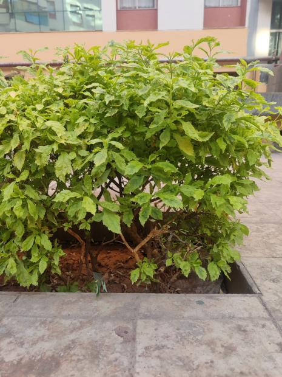
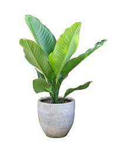
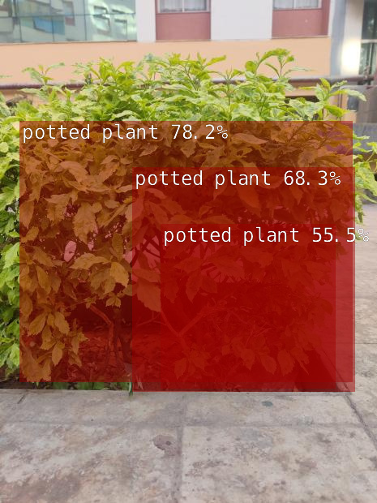
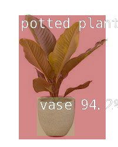
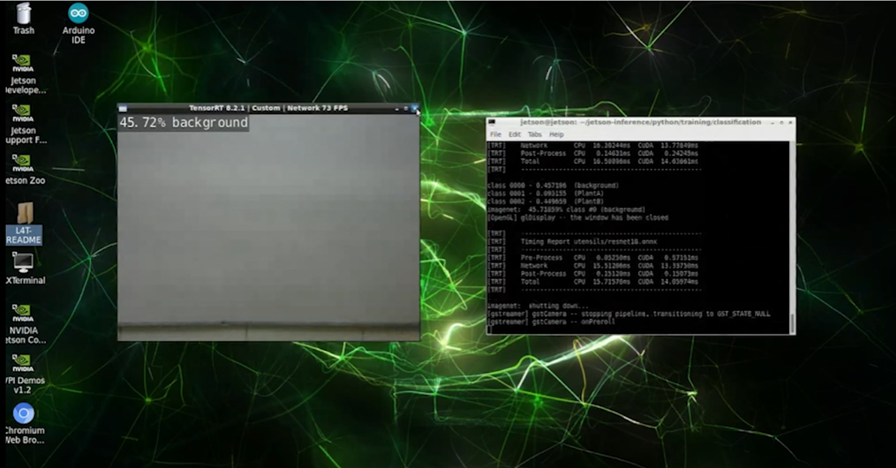
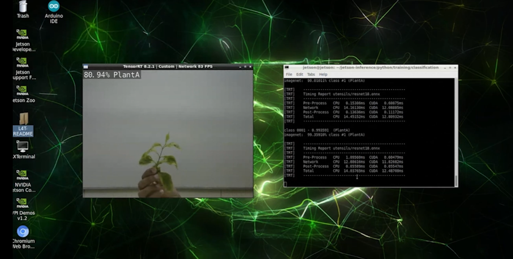

# Image classification on the Jetson Nano

Before training anything for diseases and weeds I wanted to see how fast the Nano runs a network on its own camera feed. I used NVIDIA's jetson-inference (TensorRT) for this. First I ran the stock pretrained models on downloaded images, then retrained ResNet-18 on a small dataset of my own and ran it live on the camera.

## Setting up jetson-inference

    sudo apt update
    sudo apt install -y git cmake libpython3-dev python3-numpy
    git clone --recursive https://github.com/dusty-nv/jetson-inference
    cd jetson-inference
    mkdir build
    cd build
    cmake ../

cmake opens the model downloader and the PyTorch installer. Select GoogleNet, ResNet-18 and SSD-Mobilenet-v2 in the first and PyTorch for Python 3 in the second. If they don't open they can be run later from jetson-inference/tools (download-models.sh and install-pytorch.sh).

    make -j4
    sudo make install
    sudo ldconfig

## Pretrained models on downloaded images

The stock detection model (SSD-Mobilenet-v2 trained on COCO) already knows "potted plant", so I tried it first on a couple of plant photos.

    cd ~/jetson-inference/build/aarch64/bin
    ./detectnet ~/Downloads/plant_1.jpg ~/Downloads/out_1.jpg
    ./detectnet ~/Downloads/plant_2.jpeg ~/Downloads/out_2.jpg

Input images:

 

Output images:

 

For classification the same images go through imagenet, which uses GoogleNet by default (--network=resnet-18 for ResNet-18):

    ./imagenet ~/Downloads/plant_1.jpg ~/Downloads/class_1.jpg

COCO and ImageNet only know plants in general, so the next step was to train on my own classes.

## Swap space

The Nano has 4 GB of RAM which is not enough to train with PyTorch. I added 4 GB of swap on the SD card first.

    df -h
    sudo fallocate -l 4G /mnt/4GB.swap
    sudo chmod 0600 /mnt/4GB.swap
    sudo mkswap /mnt/4GB.swap
    sudo swapon /mnt/4GB.swap

To keep it after a reboot add it to /etc/fstab:

    echo '/mnt/4GB.swap none swap sw 0 0' | sudo tee -a /etc/fstab

## Retraining ResNet-18 on my own classes

This is transfer learning. The ResNet-18 weights trained on ImageNet are the starting point and only get tuned on my images, so a small dataset is enough and it trains on the Nano itself. I used 3 classes: background, PlantA and PlantB, in a dataset folder called utensils.

    mkdir -p ~/datasets/utensils
    cd ~/datasets/utensils
    echo 'background' > labels.txt
    echo 'PlantA' >> labels.txt
    echo 'PlantB' >> labels.txt

Capture the images with the camera-capture tool. In its window set the dataset type to Classification, the path to ~/datasets/utensils and the class labels to labels.txt, then capture images of each class for the train, val and test sets.

    camera-capture --width=640 --height=480 /dev/video0

Train and export to ONNX so TensorRT can load it:

    cd ~/jetson-inference/python/training/classification
    python3 train.py --model-dir=utensils ~/datasets/utensils
    python3 onnx_export.py --model-dir=utensils

Run it on the camera:

    imagenet --model=utensils/resnet18.onnx --labels=$HOME/datasets/utensils/labels.txt --input_blob=input_0 --output_blob=output_0 /dev/video0

The test was done with a USB webcam on /dev/video0. On the robot the disease camera is the IMX219 on the CSI port, which is csi://0.

## classify.py

classify.py does the same thing as the imagenet tool from Python so I can use the result in my own code later. The input can be an image, a folder of images, a video or a camera.

    # pretrained GoogleNet on an image
    python3 classify.py ~/Downloads/plant_1.jpg ~/Downloads/class_1.jpg

    # retrained model on the CSI camera
    python3 classify.py --model=utensils/resnet18.onnx --labels=$HOME/datasets/utensils/labels.txt csi://0
