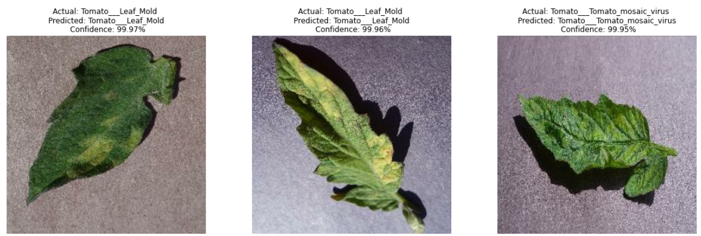
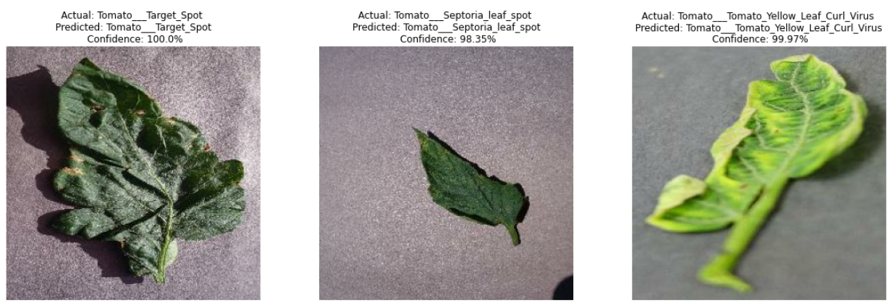
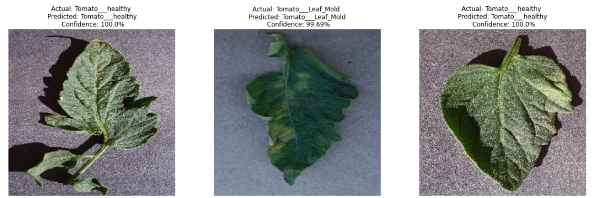

# Disease detection in tomato plants

The top camera on the robot looks at the tomato leaves. This part is the classifier behind it: a small CNN built with TensorFlow that sorts a leaf image into one of 9 common tomato diseases or healthy.

## Dataset

Tomato leaf images from PlantVillage, one folder per class. The folder names are the class names (also in class_names.txt):

- Tomato___Bacterial_spot
- Tomato___Early_blight
- Tomato___Late_blight
- Tomato___Leaf_Mold
- Tomato___Septoria_leaf_spot
- Tomato___Spider_mites Two-spotted_spider_mite
- Tomato___Target_Spot
- Tomato___Tomato_Yellow_Leaf_Curl_Virus
- Tomato___Tomato_mosaic_virus
- Tomato___healthy

The dataset and the trained model are not in the repo.

## Model

- Images are resized to 256x256 and scaled to 0-1 inside the model, so it takes raw images.
- Random flips and rotations for augmentation (only active while training).
- 6 Conv2D + MaxPooling blocks, then Dense 64 and a softmax over the classes.
- Adam with sparse categorical cross entropy, 50 epochs, batch size 32.

The image list is shuffled once with a fixed seed and split 80/10/10 into training, validation and test before anything is loaded, so the test images are never seen during training.

## Usage

    pip install -r requirements.txt

    python3 train.py ~/datasets/tomato_leaves --model-dir model
    python3 predict.py model leaf_1.jpg leaf_2.jpg

train.py saves the SavedModel, class_names.txt, the accuracy and loss curves (training.png) and 9 test predictions (predictions.png) into the model folder.

## Results

From my 50 epoch training run on 22930 images:

| | Accuracy | Loss |
|---|---|---|
| Training (last epoch) | 95.9% | 0.124 |
| Validation (last epoch) | 96.4% | 0.126 |
| Test | 96.2% | 0.121 |

That run split the data by batches after a shuffle that changed every epoch, so some test images were probably seen in training and the test number may be a little high. train.py now splits by file to avoid this.

## Predictions on test images

## On the robot

The `disease_detector` node in `agridoc_detection` runs the SavedModel on the IMX219 camera on top of the robot once a second. Healthy leaves and predictions below 80% are skipped. Every disease it finds is written to `~/.ros/agridoc/disease_log.csv` with the time and the robot's position on the map. The same disease within 0.5 m of the last one is counted as the same plant. The robot does not stop or spray for diseases. It expects the model folder (with class_names.txt) at `~/agridoc_models/disease_model`.

    ros2 run agridoc_detection disease_detector
