# Weed detection using YOLOv5

The USB webcam on the robot is tilted down at the ground between the tomato plants. This part finds weeds in its images. I trained YOLOv5s on 3 weeds that commonly grow around tomatoes:

- Weed_BlackNightshade
- Weed_CommonChickweed
- Weed_VelvetLeaf

## Workflow

- Collect weed images and split them into training and validation sets.
- Upscale the low resolution images with ESRGAN (below).
- Label them in YOLO format with makesense.ai.
- Clone YOLOv5 and train from the pretrained yolov5s.pt weights on my data (data.yaml).
- Check the curves and run detect.py on a test video.

## Dataset

The dataset is not in the repo. data.yaml expects it in datasets/weeds next to this file:

    datasets/weeds/images/train
    datasets/weeds/images/val
    datasets/weeds/labels/train
    datasets/weeds/labels/val

Some of the images I collected were very small (198x198) and blurry. I upscaled them 4x to 792x792 with [ESRGAN](https://github.com/xinntao/ESRGAN) before training.

Before:

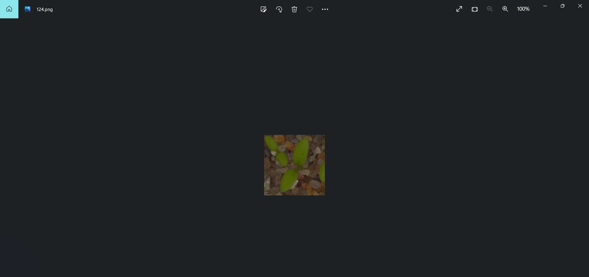

After:

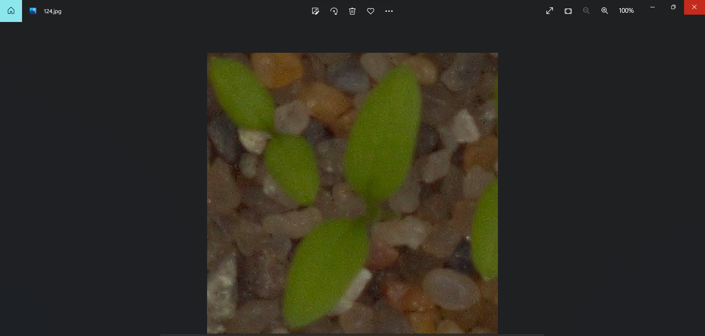

## Usage

I trained with YOLOv5 from 2022-06-20, Python 3.8 and torch 1.9.0 (CUDA 10.2) on a GTX 1650. YOLOv5.ipynb has all the steps:

1. Clone YOLOv5 and check out that version.
2. Install requirements.txt (torch) and the YOLOv5 requirements.
3. Train:

        python3 train.py --img 640 --batch 12 --epochs 50 --data ../data.yaml --weights yolov5s.pt --cache

4. Detect on the test video (My_video.mp4 next to this file):

        python3 detect.py --weights runs/train/exp/weights/best.pt --img 640 --conf 0.25 --source ../My_video.mp4

detect.py also takes an image, a folder or a webcam (--source 0). The trained weights and the test video are not in the repo.

## Results

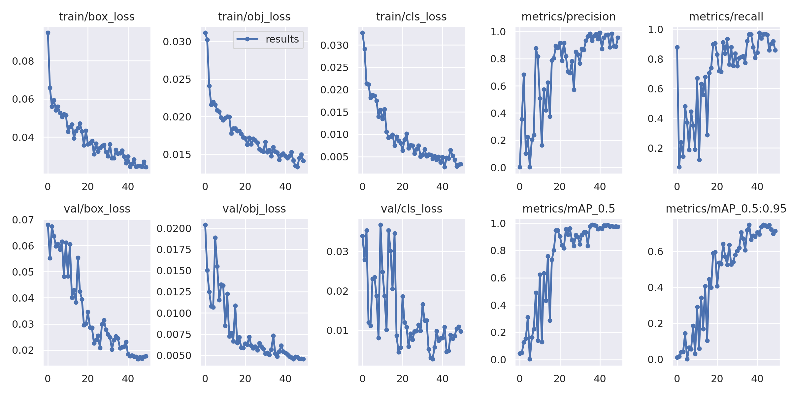

F1, precision, recall and precision-recall curves:

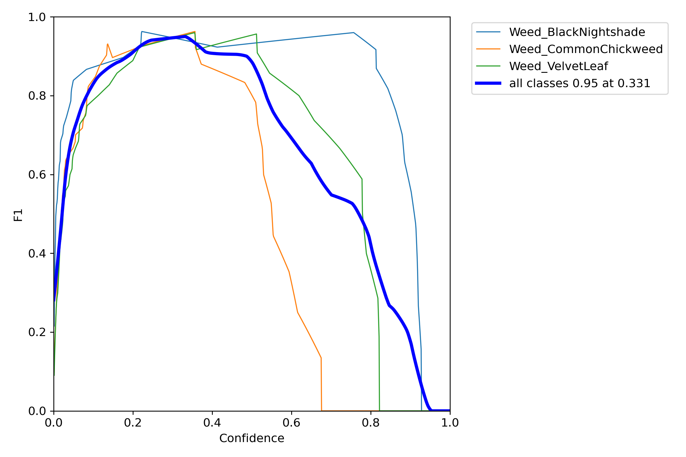

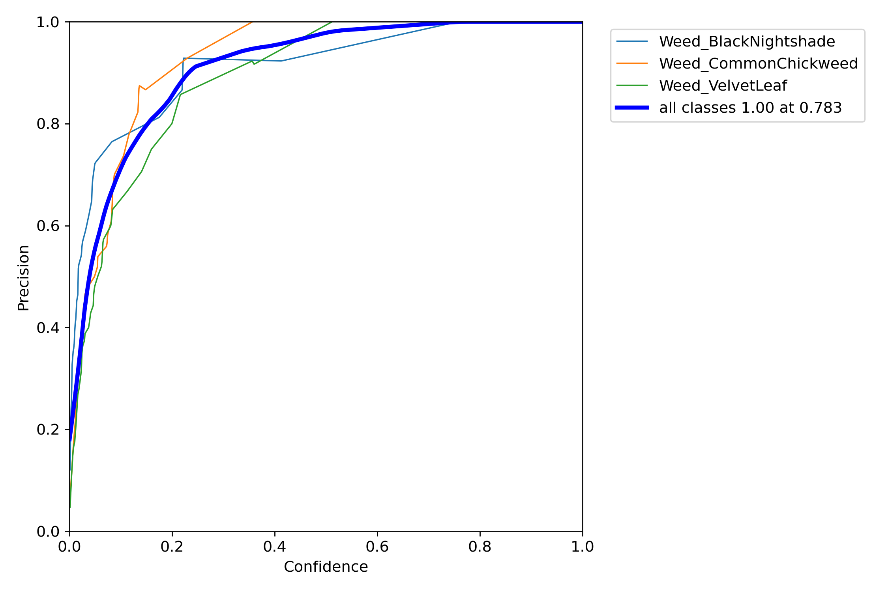

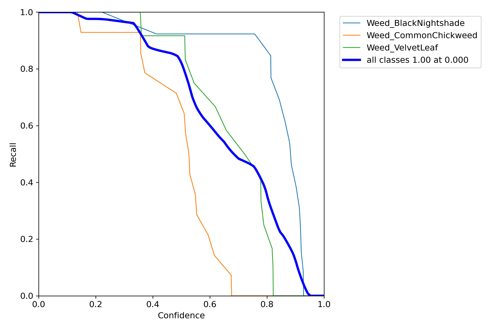

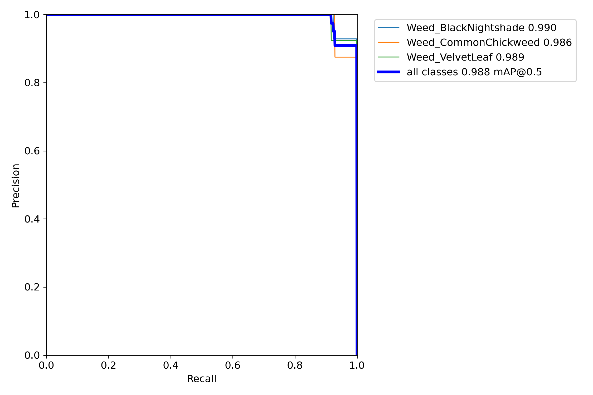

## Detections

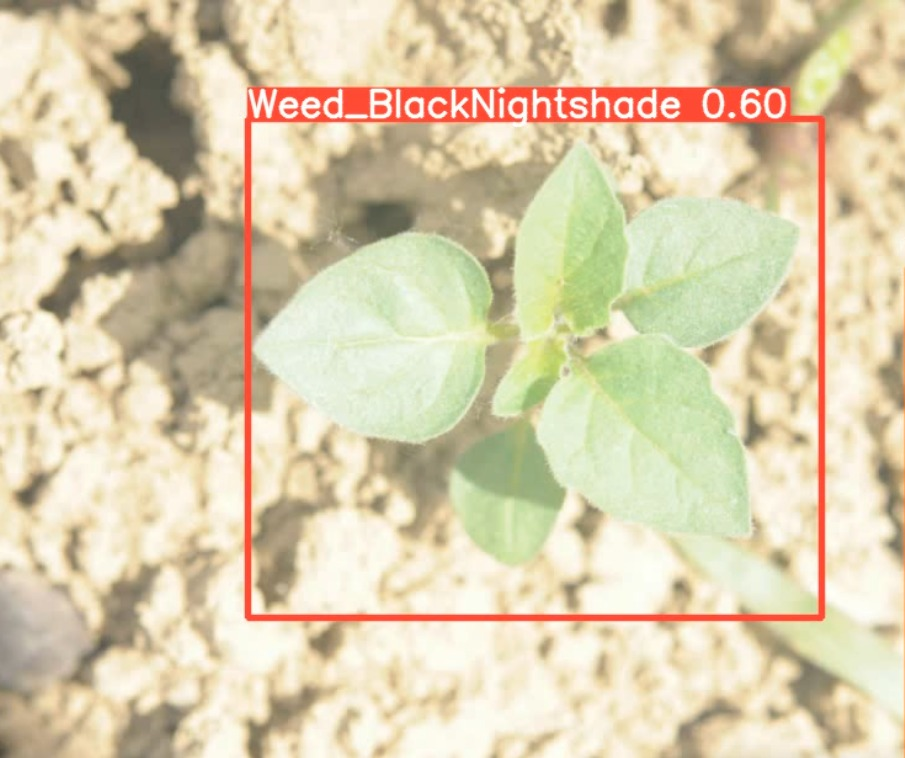

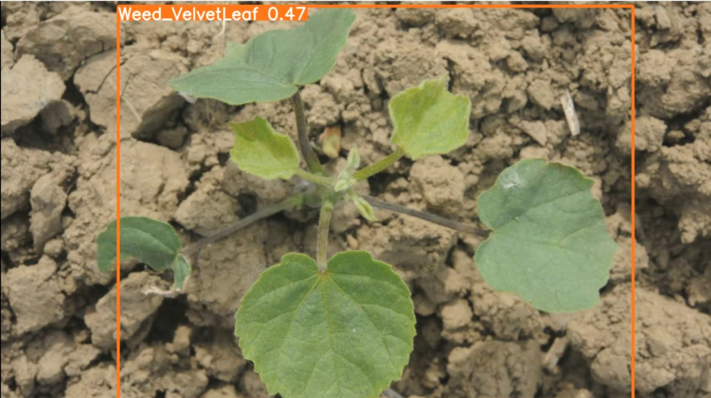

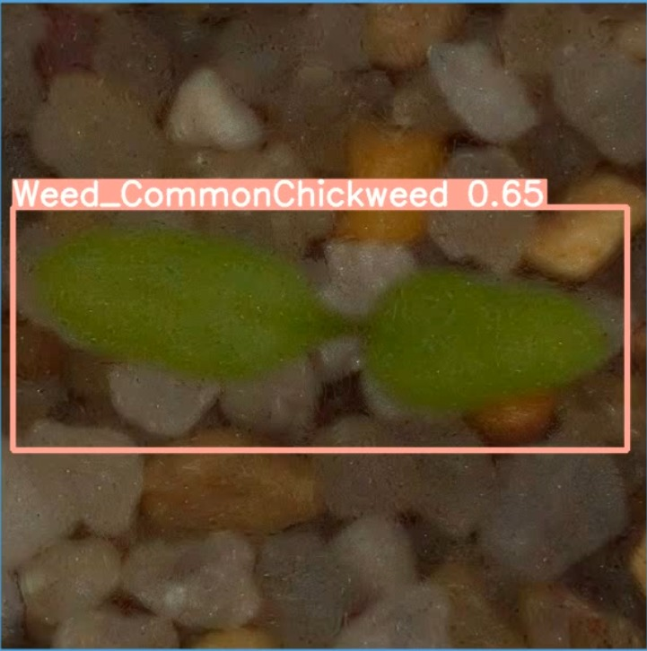

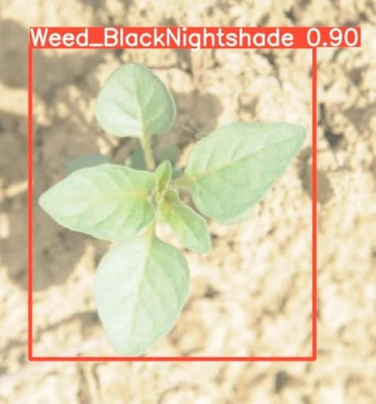 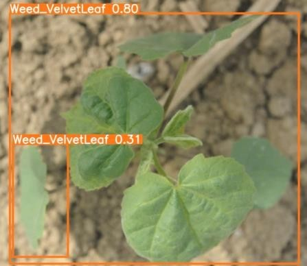
